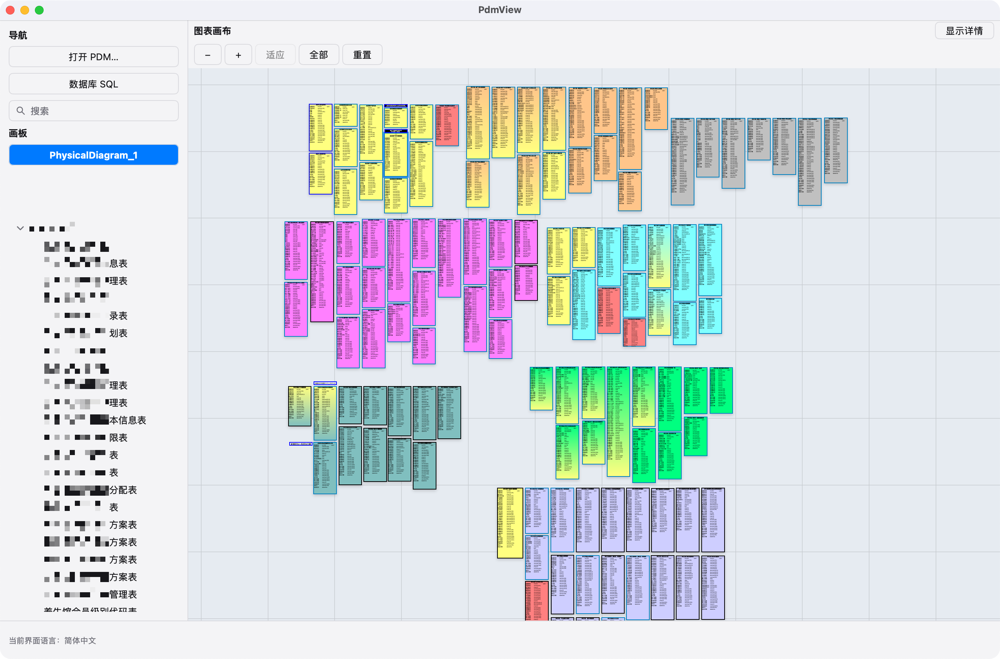
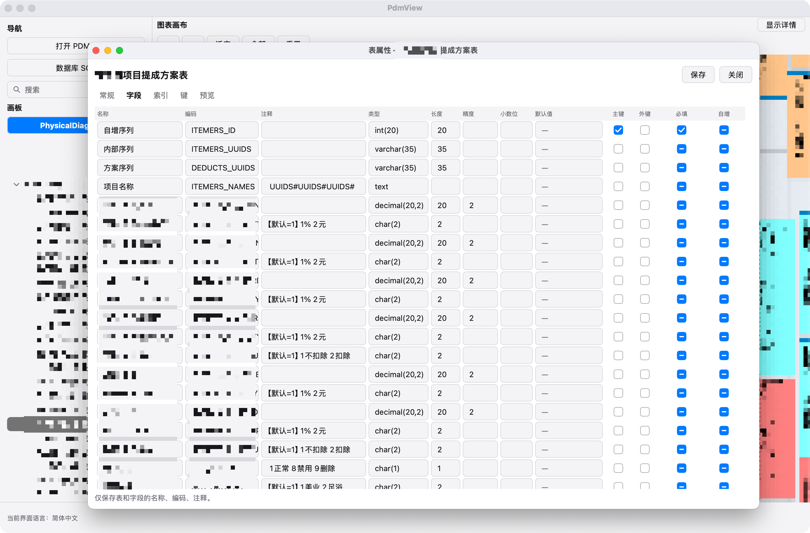
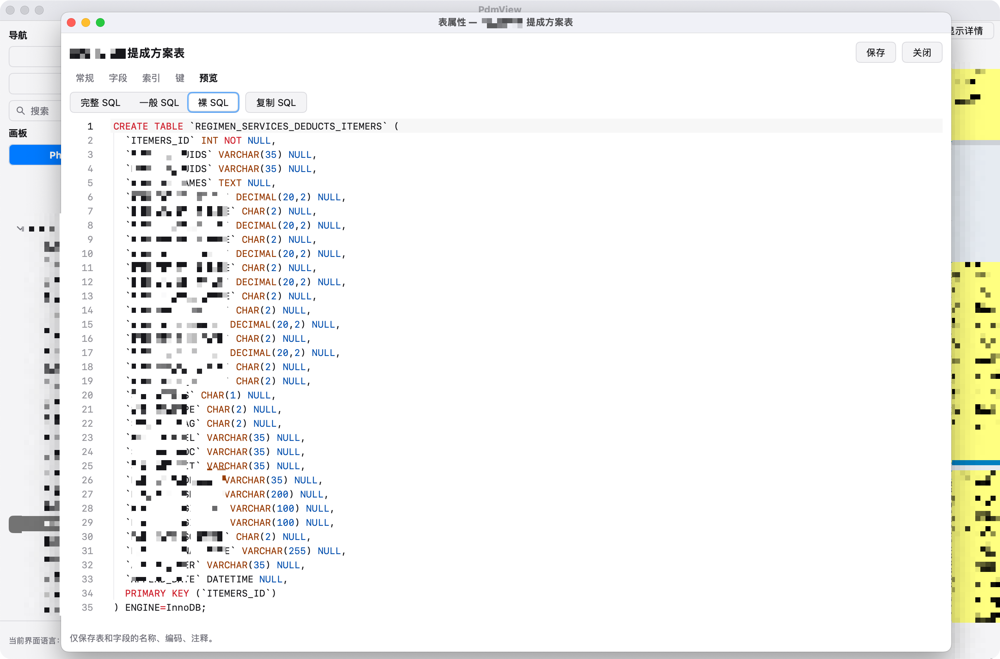
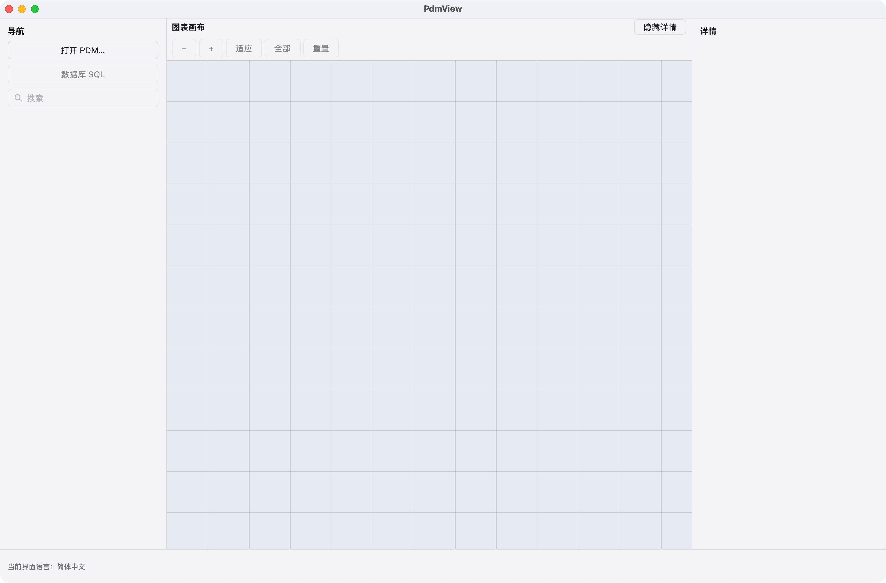

# PdmView

PdmView 是一款原生桌面应用，用于在本地查看 PowerDesigner `.pdm` 数据库模型、查询表结构，以及预览和导出 MySQL 8.0 建表 SQL。

> **当前版本仅建议用于查询和浏览。** 界面中仍有「保存」按钮，但修改后的 `.pdm` 能否在不同版本的 PowerDesigner 中正常打开尚未经过兼容性测试，请勿修改或保存原始模型。画板支持缩放和平移，暂不支持拖拽表来重新排版。



## 主要功能

- **查看模型**。浏览原始画板、表关系和 Package，缩放或平移画布，搜索并定位表。
- **查看表属性**。双击画布中的表，查看字段、数据类型、主键、外键和索引。可沿外键关系跳到关联表。
- **生成 MySQL 8.0 SQL**。单表支持「完整 SQL」「一般 SQL」「裸 SQL」三种预览。全库可查看生成诊断、预览、复制或导出 `.sql`。
- **界面偏好**。支持简体中文和英文，可选择亮色、暗色或跟随系统。

## 快速开始

启动 PdmView 后，点「打开 PDM…」，选择 UTF-8 XML 格式的 `.pdm` 文件。选中画板就能浏览模型，按住 `Ctrl` 滚动鼠标滚轮可按指针位置缩放。需要生成全库脚本时，打开「数据库 SQL」。

| 平台 | 运行与验收状态 |
| --- | --- |
| macOS Apple Silicon | 需要 macOS 13.0 或更新版本。解压 ZIP 后打开 `PdmView.app`。已有本地构建和桌面验收记录。 |
| Windows x64 | 解压 ZIP 后运行 `PdmView.exe`。已有交叉构建记录，Windows 桌面验收待完成。 |

打包命令、签名状态和产物校验见[发布记录](RELEASE.md)。输入格式和已验证样本见 [PDM 格式验证](docs/PDM_FORMAT.md)，SQL 生成范围见 [MySQL 类型映射](docs/MYSQL_TYPE_MAPPING.md)。

## 界面截图

### 表属性



### 单表 SQL 预览



<details>
<summary>启动后的空白工作区</summary>



</details>

## 从源码运行

项目使用 Go 和 MyGo Native UI。最低需要 Go 1.27.3，已用 Go 1.27.4 构建。以下命令在仓库根目录执行。

**macOS**

```sh
CGO_ENABLED=0 go run ./cmd/pdmview
```

**Windows PowerShell**

```powershell
$env:CGO_ENABLED = '0'
go run -tags 'mygo_noinspector,mygo_nowebview' ./cmd/pdmview
```

可以在命令末尾传入 `.pdm` 路径，启动时直接打开模型。开发入口、测试和项目结构分别见[开发指南](DEVELOPMENT.md)和[架构说明](ARCHITECTURE.md)。

## 许可证

PdmView 自有代码采用 **GNU GPL v3.0（仅第 3 版，`GPL-3.0-only`）**，完整条款见 [LICENSE](LICENSE)。对外发行二进制时，请按许可证提供同版本对应源码。第三方许可证和源码发行方式见[发布记录](RELEASE.md#依赖与许可证)。
