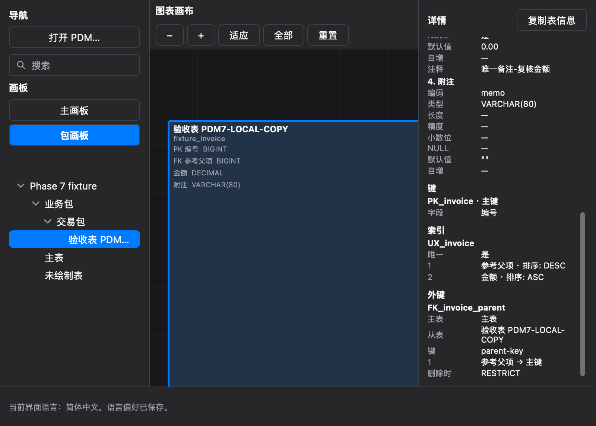

# PdmView

PdmView 是使用 Go 与 MyGo Native UI 的 PowerDesigner `.pdm` 查看器，支持有限的副本编辑。

- 查看原始画板、关系线、Package、表和字段。支持缩放、平移、搜索和定位。
- 复制完整表信息或单表建表 SQL。预览、复制和导出 MySQL 8.0 全库初始化脚本。
- 在「设置 → 语言」/「Settings → Language」切换简体中文和英文。首次启动使用系统首选界面语言，之后恢复已保存的选择。



## 开发与验证

在本目录运行命令。项目要求 Go 1.27.3，已用 Go 1.27.4 和 MyGo `v0.10.0` 验证。默认准备 macOS Apple Silicon 开发环境。

```sh
make env    # 复查机器、构建工具和本地样本元信息
make fmt    # 格式化 Go 源码
make check  # 验证格式，运行 go test ./... 和 go vet ./...
make probe  # 启动 Phase 0 独立原生探针
CGO_ENABLED=0 go run ./cmd/pdmview  # 启动原生应用
CGO_ENABLED=0 go run ./cmd/pdmview /path/to/model.pdm  # 直接打开本地模型
```

`cmd/mygo-probe/` 是技术验证入口，显示两张模拟表。正式应用的目录边界见 [ARCHITECTURE.md](ARCHITECTURE.md)，验证步骤见 [MyGo API 验证](docs/MYGO_API_VERIFICATION.md)，任务进展见 [任务状态](tasks/TASK_STATUS.md)。

应用启动时展示模拟图。使用导航栏的「打开 PDM…」/「Open PDM…」选择本地模型，或在命令行直接传入文件路径。选择画板后可拖动画布或滚轮平移，用 Ctrl 加滚轮或触控板捏合按指针位置缩放。工具栏提供缩放、适应选中、显示全部和重置视图。

双击画布中的表可打开独立的原生表属性窗口。拖动窗口边缘可调整大小，编辑框支持选取、复制和修改。点击「另存 PDM 副本…」可将当前表和所属字段的名称、编码、注释保存到新的 `.pdm` 文件。源文件和已有文件保留原样。其他编辑是窗口内草稿，关闭窗口后丢弃。

画板、语言和系统服务的跨平台验收见 [Phase 10 验收](docs/PHASE_10_ACCEPTANCE.md)。

真实样本放在 `.local/fixtures/`。本地日志、运行截图和二进制放在 `.out/`。

## 平台与兼容范围

- macOS Apple Silicon 候选的最低系统版本为 13.0，桌面验收使用 macOS 15.8.1。Windows x64 的构建和桌面验收进度分别记录在 [发布记录](RELEASE.md)。
- 输入为 UTF-8 XML `.pdm`。本地真实样本为 PowerDesigner `16.5.0.3982`，另对照 `12.5.0.2169`、`15.1.0.2850`、`16.5.0.3982` 的公开 XML 导出。P4-03 的 PowerDesigner 应用内坐标与路径对照待完成。具体结构和样本边界见 [PDM 格式验证](docs/PDM_FORMAT.md)。
- SQL 以 MySQL 8.0 为目标，已在隔离的 MySQL 8.0.46 实测。未知类型或有冲突的类型参数会阻止生成。完整白名单和限制见 [类型映射](docs/MYSQL_TYPE_MAPPING.md)。
- PdmView 以只读方式打开 PDM。导出的 SQL 由用户在目标数据库环境中执行。

## 文档索引

- `CODEX_START_PROMPT.md`：直接粘贴给 Codex 的启动指令。
- `PROJECT_BRIEF.md`：产品范围、技术边界和验收口径。
- `ARCHITECTURE.md`：模块边界、数据流、关键设计约束。
- `AGENT_WORKFLOW.md`：双模型分工、交接和冲突处理。
- `QUALITY_GATES.md`：阶段门禁、测试及性能验收。
- `DEVELOPMENT.md`：开发环境、构建入口和测试。
- `RELEASE.md`：候选产物、校验和、签名及平台验收。
- `tasks/00_ROADMAP.md`：阶段顺序与依赖。
- `tasks/TASK_STATUS.md`：任务状态登记表。
- `tasks/PHASE_*.md`：各阶段任务卡。
- `templates/AGENT_HANDOFF.md`：执行 Agent 交接模板。
- `templates/BUG_REPORT.md`：问题报告模板。
- `templates/DECISION_RECORD.md`：技术决策记录模板。

## 重要约束

- PDM 源文件以只读方式打开。另存副本仅写入现有表和字段的名称、编码与注释，保留其他 XML 字节。
- 先验证 MyGo Native UI 和绘制 API，再开发正式界面。
- 原始 Diagram 布局优先；只有缺少有效布局时才使用自动布局。
- 未知 XML 节点、属性和对象引用不得静默忽略，必须产生诊断。
- SQL 生成必须有明确的类型映射规则；未知类型不得擅自降级成 VARCHAR。
- 单表 SQL 与全库 SQL 必须共用同一套 Generator。
- 不把 Draw 回调当作业务计算入口；布局、解析、文本测量和空间索引更新必须在绘制前完成。
- 不允许用模拟 PDM 解析结果冒充真实 PDM 兼容性。
